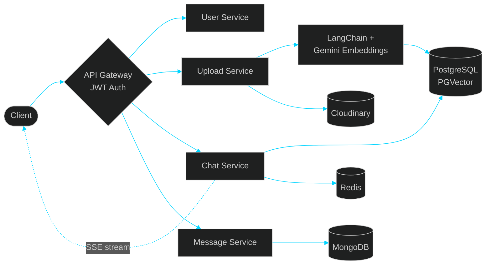
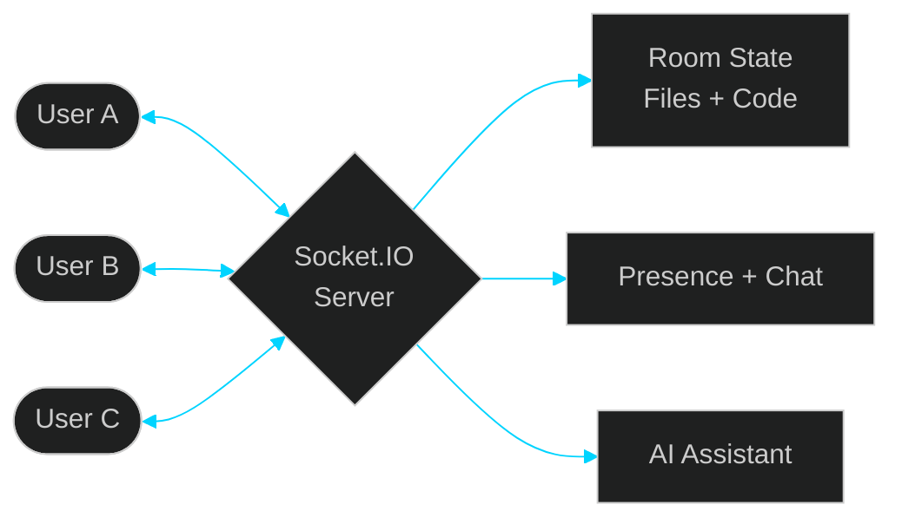

<!-- ═══════════════ HEADER ═══════════════ -->

  

  

  
  
  
  

## 👋 About Me

I'm a Computer Science undergraduate with hands-on experience building **full-stack, real-time, microservices and AI-powered applications**. I enjoy production-style systems: Retrieval-Augmented Generation (RAG), vector search, API gateways, authentication and real-time communication.

## ⚡ Tech Stack

  

  
  
  
  
  
  

<table align="center">
<tr><td><b>💻 Languages</b></td><td>Java · JavaScript · TypeScript · Python · HTML · CSS</td></tr>
<tr><td><b>🎨 Frontend</b></td><td>React.js · Tailwind CSS</td></tr>
<tr><td><b>⚙️ Backend</b></td><td>Node.js · Express.js · REST APIs · Socket.IO · Microservices</td></tr>
<tr><td><b>🗄️ Databases</b></td><td>MongoDB · PostgreSQL · PGVector · Redis · Supabase</td></tr>
<tr><td><b>🤖 AI / LLM</b></td><td>RAG · LangChain · Google Gemini API · Embeddings · Vector Search</td></tr>
<tr><td><b>🧰 Tools</b></td><td>Git · GitHub · Postman · VS Code</td></tr>
</table>

## 🚀 Featured Projects

### 🧠 XLR8: AI-Powered Document Chat Platform

- Microservices (**User, Upload, Chat, Message**) behind a centralized **API Gateway**
- **RAG pipeline**: LangChain + Gemini embeddings, vectors stored in PostgreSQL with PGVector
- Combines retrieved document chunks with conversation history for grounded AI answers
- Centralized **JWT authentication** with HTTP-only cookies and user-context propagation
- Token-level **SSE streaming**, Redis caching, Cloudinary file storage, MongoDB persistence

 

### ⚡ Orynto: Real-Time Collaborative Code Editor

- Room-based multi-user sessions with synchronized code updates across multiple files
- File/folder management, syntax highlighting, language detection, **code execution**, autocomplete, themes and ZIP download
- Presence tracking, group chat, join/leave notifications, live selections and active-editor visibility
- **AI coding assistant** (insert / copy / replace) and a collaborative real-time drawing workspace

 

### 🎬 StreamNest: Scalable Video Sharing Platform

- Secure auth, channels, video uploads, playlists, subscriptions, watch history, comments, likes and profiles
- REST APIs with **JWT**, role-based authorization, input validation and MVC architecture
- Faster queries with **MongoDB aggregation pipelines**, pagination, indexing and search
- Cloudinary pipeline for secure uploads, automatic optimization and reliable delivery

  

## 🏆 Certifications

   
   
   
  

## 🤝 Let's Connect

  
  
  
  

  

  

